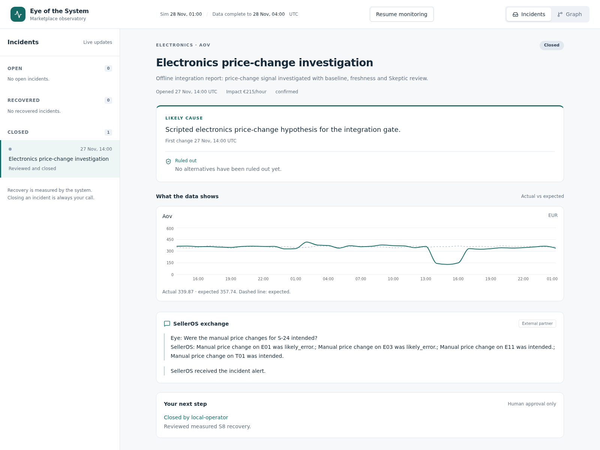

# Eye of the System



The React incident workspace after an offline, scripted S8 run: investigation report, measured evidence, SellerOS exchange and human closure.

Eye of the System monitors a marketplace's metric graph, ranks unusual changes by business impact, investigates explanations with evidence, and publishes incidents for human review. Deterministic warehouse tools compute the numbers; agents decide what to investigate and how to explain it. The included continuous simulator supplies S8: a seller's price typo during a planned electronics coupon day.

## Architecture

The [Compose stack](compose.yaml) runs:

- `sim` → hourly Parquet lake → `eye-data` (DuckDB, metric registry, graph and deterministic tools).
- `eye-core` (FastAPI, DBOS workflows and incident control) with `postgres` for durable workflow/control state.
- `sentinel`, `detective`, `skeptic`, `reporter`, `cartographer`: independently served A2A agents using PydanticAI and `agent_runtime`.
- `eye-specialists`: Growth, Marketplace and Discovery A2A endpoints; `selleros`: independent seller-side service.
- `web`: React workspace behind nginx; `eye-mcp`: MCP facade over Core.
- `lgtm`: Grafana, logs, metrics and traces; `egress-proxy`: allowlisted agent internet access.
- `auth`: OAuth client-credentials issuer and signing authority for A2A agent cards.

See the [architecture](docs/specs/architecture.md) and [documentation index](docs/README.md).

## Quickstart

Requires Docker with Compose v2 (including `!reset`/`!override` support).
For the host demo CLI and development, install [uv](https://docs.astral.sh/uv/);
the workspace uses Python 3.13.

```bash
cp .env.example .env
docker compose up -d --build --wait
uv sync --locked
uv run demo trigger s8
```

The installed CLI command is `demo trigger s8`; `uv run` selects the workspace environment.
Open the **UI at http://localhost:8080** and **Grafana at http://localhost:3000**.
The simulator is at http://localhost:8100; the MCP port defaults to the first free port in 8110–8119.
`uv run demo status` shows simulator/Core status; `uv run demo narrate` prints the incident story.

Startup and smoke checks need no model key. Live investigations do: configure the provider/model under
`llm` in [config/compose.yaml](config/compose.yaml) and the corresponding key in `.env`.
Compose starts Core monitoring paused (`sim.autostart: false`); resume it in the UI after configuring a model.
The simulator itself advances continuously. A credential-free, scripted S8 run is below.

Scale Detective without assigning fixed host ports:

```bash
docker compose up -d --scale detective=3
docker compose down
```

Named volumes retain data on shutdown. The S8 test requires a fresh project with no prior incidents;
use a separate project name rather than deleting a live project's volumes.

## Service authentication

Every A2A JSON-RPC call requires a short-lived RS256 JWT from `auth`. Scopes are
`<agent>:<skill_id>`; Core's seller price-revert endpoints require `selleros:revert`
instead of a static service token. The human operator token is unchanged. Missing or
invalid JWTs return 401; insufficient scopes return 403 (or a failed multi-skill task).
Agent cards and health endpoints remain public. Services enroll signed cards at startup;
callers verify signatures against the issuer's JWKS before routing and reject unsigned
or tampered cards. Being on a Compose network does not grant access.

Copy the development-only `EYE_AUTH_<CLIENT>_SECRET` values from `.env.example` and
replace them outside local development. Compose supplies each client only its own secret
and uses `EYE_AUTH_URL=http://auth:8500`. Standalone callers set `EYE_AUTH_CLIENT_ID` and
`EYE_AUTH_CLIENT_SECRET`; client scope grants and secret environment names live in
`config/auth.yaml` (`EYE_AUTH_CONFIG` overrides the path). The issuer persists its key in
the `auth-keys` volume (`EYE_AUTH_KEY_PATH` overrides the file path); retain it across restarts.
Local Compose explicitly sets `AUTHLIB_INSECURE_TRANSPORT=1` for internal HTTP. Shared or
production deployments must use TLS and remove that exception. See
[Eye Auth](packages/auth/README.md) for endpoints and library usage. The offline gate below
also checks missing-token 401, wrong-scope 403, and unsigned/tampered-card rejection.

## Connect real data

Compose Core uses `EYE_DATA_URL=http://eye-data:8150`, not an in-process simulator.
The data service's [ParquetLanding](packages/data/src/eye/warehouse/landing.py) imports published hourly
partitions from `SIM_LAKE_DIR` (default `data/lake`). A real ingestion pipeline must supply the
[warehouse schema](packages/data/src/eye/schema.py), including `partition_status` manifests, or implement
the typed [warehouse operations](packages/data/src/eye/warehouse/operations.py) and point Core and agents'
`EYE_DATA_URL` at that compatible service. Configure metrics, identities and causal seeds in `config/`.
Changing the root data-source setting alone does **not** replace the Compose ingestion pipeline.

For embedded/local Core without `EYE_DATA_URL`, implement
[`DataSource`](packages/orchestrator/src/eye/datasource.py): `now`, `history_start`, `live_start`,
`step()`, `cursor()` and `close()`. `data.source: duckdb` plus `data.path` selects the existing
DuckDB adapter; `data.source: sim` selects the simulator. A new adapter also needs an `open_source()`
dispatch branch. Settings are YAML, not a generic `EYE_DATA_SOURCE` environment override.
See [data](docs/specs/data.md) and [deployment](docs/specs/deployment.md).

## Development

```bash
uv sync --locked
uv run ruff check . && uv run ruff format --check .
uv run lint-imports
uv run vulture
uv run pytest -m "not live" -q
uv run python scripts/agent_evals.py
```

Normal tests and PR evals never call real models. See [AGENTS.md](AGENTS.md) for package boundaries,
test policy and PR rules. Frontend commands are in [packages/web/README.md](packages/web/README.md).

Run the offline integration gate in a fresh, isolated Compose project
(choose a new project name for another run):

```bash
export COMPOSE_FILE=compose.yaml:compose.e2e.yaml
export COMPOSE_PROJECT_NAME=eye-s8-check
export COMPOSE_DISABLE_ENV_FILE=1
docker compose up -d --build --wait --scale detective=3 && ./scripts/smoke.sh && ./scripts/e2e-s8.sh
docker compose down
```

The override uses a scripted model provider and isolated test settings; do not use it for live investigations.
See [testing](docs/specs/testing.md), [demo](docs/specs/demo.md) and the
[production criteria](docs/specs/agent-criteria.md).
