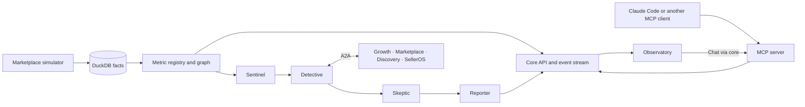

# Eye of the System

Eye of the System monitors a graph of metrics without waiting for someone to ask a question. It ranks unusual changes by business impact, investigates possible causes, and publishes incidents with evidence and suggested actions. The platform is not tied to one use case: in [“The €9 headphones”](docs/specs/15-demo-and-pitch.md#1-demo-script-3-min-the-9-headphones), a simulated marketplace investigates one seller's unplanned price drop during a planned electronics coupon day.

## Observatory

The [live observatory](web/README.md) is served by Core. [Earlier API preview](docs/assets/observatory-live.png): the chart shows simulated orders after injecting I1 and S7, not results from the headphones rehearsal.

## Run it

Core is now a deterministic DBOS workflow worker, not an agent host. It queues
completed data hours and calls Sentinel (`detect`), Detective (`investigate`),
Reporter (`report`), and Cartographer (`map`) over JSON-RPC A2A. Agent services
are delivered separately by W3-9; configure their URLs under `a2a` in settings.
There is no startup Cartographer refinement. Without reachable agents Core
still serves the public API, but cannot produce new investigations.

Compose persists workflows, approvals, kill switches, and the hash-chained audit
ledger in Postgres 17 (`EYE_DATABASE_URL`). Local development defaults to
`sqlite:///data/control.sqlite`; offline workflow tests need no Postgres service.
Incident history remains compatible with the existing DuckDB operations store.
The `map` skill returns a validated metric proposal only: the read-only data
service currently has no registry write endpoint, so Core does not persist it.
Human mutations (kill/clear, approval decisions, recovered incident close) use
`request.state.person`, falling back to the trusted `X-Eye-Person` header.
The reverse proxy must strip untrusted values and supply the verified identity;
requests without either identity return 401. Closing requires a note and a
recovered incident; agents cannot close incidents.

### Docker Compose (live stack or credential-free wave gate)

```sh
cp .env.example .env
docker compose up -d --build --wait
./scripts/smoke.sh
docker compose ps
# Stop, preserving data (add -v to reset the world):
docker compose down
```

Open http://127.0.0.1:8000 for the UI served by Core. Each Python service has
its own container and HTTP health check. The continuous simulator backfills or
resumes its private `sim-world` volume and publishes hourly Parquet to
`sim-lake`. `eye-data` mounts the lake read-only and serves it to Core on a
private network; no warehouse port is published. The simulator also publishes
the shared SellerOS export. The simulator uses host port 8100 and MCP starts at 8110.
Host ports can be changed in
`.env`. Compose uses the normal live Anthropic LLM defaults, matching
`config/settings.yaml`. Set `ANTHROPIC_API_KEY` in `.env` to run real agents;
Compose does not override credentials. For OpenRouter, add the same `llm`
provider/model settings shown below to `config/compose.yaml`, set
`OPENROUTER_API_KEY` in `.env`, and add SellerOS's provider/model variables there
too. Never commit keys.

With empty keys, the startup/API smoke makes no model requests. Core never
constructs a model client or runs seed refinement.
CI uses the fail-closed offline S8 variant below to exercise the agents as well.
The simulator runs independently of Core's clock controls. Core only advances
when the warehouse has another complete hour, and keeps its existing incident
volume. Do not scale `sim` against the same world and lake volumes.
Containers bind
`EYE_BIND_HOST=0.0.0.0`; local commands still default to `127.0.0.1`.
`EYE_CORE_URL`, `EYE_MCP_URL`, and `SELLEROS_URL` configure network addresses;
`EYE_MCP_ALLOWED_HOSTS` adds comma-separated Host headers to MCP's loopback
allowlist (Compose adds `eye-mcp:8100`), retaining DNS-rebinding protection;
the A2A URLs live in settings. SellerOS uses `SELLEROS_DATA_DIR` for its shared
export directory. Compose uses host port ranges and no fixed container names,
so services can be independently replicated (for example,
`docker compose up -d --wait --scale eye-specialists=2`).
Core and SellerOS currently retain process-local state/file-backed storage;
multiple replicas are not a distributed-state or multi-writer deployment.

Sentinel, Detective, Skeptic, Reporter, and Cartographer have private A2A
endpoints at their Compose service names on ports 8210–8250, respectively.
Discover each at `/.well-known/agent-card.json`. To run multiple replicas,
use `docker compose up -d --wait --scale detective=3`. Use blocking A2A
sends: task state stays with the replica that handles a request.
The A2A Detective delegates only to Skeptic: legacy specialists and SellerOS
do not accept budgets or report usage yet. The legacy Core path is unchanged.

### S8 demo against the running continuous stack

Start the stack with `docker compose up -d --build --wait` as above, then run
from the checkout root:

```sh
uv sync --locked
uv run demo trigger s8
uv run demo status
uv run demo narrate
```

Compose starts the continuous `sim` service. The CLI never starts, resets,
pauses or advances simulation, adds metrics, or calls a model. Only `trigger`
writes, via the simulator's scenario endpoint. S8 starts the planned coupon day
immediately and the seller typo after `typo_delay_hours` (default 1).

Defaults are simulator `http://127.0.0.1:8100` and Core `http://127.0.0.1:8000`.
Set `DEMO_SIM_URL` / `DEMO_API_URL`, or use global options before the command:
`uv run demo --sim-url http://127.0.0.1:9100 --api-url http://127.0.0.1:8000 status`.

`status` lists non-terminal incidents. `narrate --interval 2 --timeout 180`
prints S8 activation and changed incident titles, Reporter summaries,
investigation IDs and verdicts exposed by Core's public `/api/incidents` endpoint.
It observes **all** incidents: that endpoint does not identify an S8 incident.
By default it exits successfully when an incident observed as non-terminal becomes
resolved/closed, and fails on timeout. Existing resolved incidents do not satisfy
that condition. Use `--until timeout` to observe for the full duration and exit
successfully, or Ctrl+C to stop. It does not promise the scripted D6 timeline.

### Play S8 with Compose

**Live (funded model calls):** set `ANTHROPIC_API_KEY` in `.env` first, then:

```sh
docker compose up -d --build --wait
SIM_URL="http://$(docker compose port sim 8100)"
CORE_URL="http://$(docker compose port eye-core 8000)"
curl -fsS -X POST "$SIM_URL/scenarios/s8"
curl -fsS -X POST "$CORE_URL/api/clock/resume"
curl -fsS "$SIM_URL/status"
curl -fsS "$CORE_URL/api/incidents"
# Follow the investigation in the UI at $CORE_URL; clear the scenario when done:
curl -fsS -X DELETE "$SIM_URL/scenarios/s8"
docker compose down
```

**Offline wave gate (no keys, Docker Compose ≥2.24.4):**

```sh
export COMPOSE_FILE=compose.yaml:compose.e2e.yaml
export COMPOSE_PROJECT_NAME=eye-s8-e2e
export COMPOSE_DISABLE_ENV_FILE=1
docker compose down -v
docker compose up -d --build --wait
./scripts/smoke.sh
./scripts/e2e-s8.sh
docker compose down -v
unset COMPOSE_FILE COMPOSE_PROJECT_NAME COMPOSE_DISABLE_ENV_FILE
```

The S8 gate uses the continuous simulator's live Parquet lake through `eye-data`;
Core has no scenario-injection or in-process simulator override.

The override removes `.env` injection, clears real provider credentials, and points
all model configuration at a test-only, non-forwarding OpenAI-compatible server in
`tests/e2e/`. Unknown models/turns and failed tools fail closed; no replay miss can
reach a real provider. The existing `s8.jsonl` recording contains triage/specialist
responses but no completed Detective submission, so it cannot cover this gate.
The driver injects S8 through the simulator API, steps Core's consumer clock,
and polls Core's public APIs for an open, investigated incident with real
tool outputs, Skeptic review and a Reporter narrative. Failures print Compose logs.
This is an integration/transport gate with scripted verdicts, **not an evaluation
of model reasoning or the full D6 SellerOS correction/resolution oracle**. It runs
separately from normal `pytest -m "not live"`; the latter tests the scripted
provider without starting containers. CI's `compose-smoke` job runs both the
startup smoke and this S8 gate, then always removes its volumes.

### Local provider configuration

From a fresh checkout of `main` with [uv](https://docs.astral.sh/uv/getting-started/installation/) and Bash 4.3 or later (required by the stack launcher):

```sh
uv python install 3.13
uv sync --locked
```

**Claude (default):** Set `ANTHROPIC_API_KEY` from a funded workspace in the environment that starts the stack. Core, the specialists, and SellerOS use Claude by default.

**OpenRouter (alternative):** Set `OPENROUTER_API_KEY` in the stack's environment. Change these values in your local `llm` section; keep the rest of the file unchanged:

```yaml
llm:
  provider: openai_compatible
  prices:
    claude-opus-5-5: {input_per_mtok: 5.0, output_per_mtok: 25.0}
    nvidia/nemotron-3.5-lightning:free: {input_per_mtok: 0.0, output_per_mtok: 0.0}
    nvidia/nemotron-3-ultra-550b-a55b:free: {input_per_mtok: 0.0, output_per_mtok: 0.0}
  models:
    default: nvidia/nemotron-3.5-lightning:free
```

SellerOS does not read Core's settings. Before starting the stack, set its [provider and model](packages/selleros/README.md) in the same shell:

```sh
export SELLEROS_PROVIDER=openai_compatible
export SELLEROS_MODEL=nvidia/nemotron-3.5-lightning:free
```

Core and SellerOS already default to `https://openrouter.ai/api/v1` and read the key from `OPENROUTER_API_KEY` in this mode. Do not put API keys in settings or commit local overrides. A free-model D6 eval did not pass; see [Eval results](#eval-results).

To save LLM responses to `data/llm_cache.jsonl`, set `llm.mode: record` in your local settings before launch. Keep the cache out of git and use `llm.mode: replay` for the next launch. Replay may still call the API on a cache miss. The LLM mode is read only at startup; there is no runtime switch.

### Separate read-only data service

With a running Parquet producer, start `uv run eye-data` with the same `SIM_LAKE_DIR`
(default `data/lake`). To use an existing warehouse instead, set `EYE_WAREHOUSE_PATH`
on the data service. Check readiness at `http://127.0.0.1:8150/healthz`; it returns
the completed time range once at least one hour is ready.

Run `EYE_DATA_URL=http://127.0.0.1:8150 uv run eye-core` to read metrics, the causal
graph, and partition status over HTTP. The Core clock consumes completed hours
without advancing the producer. Scenario controls belong exclusively to the
[simulator service](sim/README.md); Core, MCP, chat and the Observatory do not
expose them. Adding metrics from SQL remains available only in legacy local mode.

## Workspace layout

The implicit `eye` namespace is split across `packages/{contracts,data,llm,agents,orchestrator,specialists,mcp}/src/eye` and `sim/src/eye/sim`. SellerOS lives independently in `packages/selleros`. The reusable `agent_runtime` package lives in `packages/agent_runtime/src/agent_runtime` and imports neither Eye nor SellerOS. Eye tests and scripts stay at the root; the LLM member owns shared prompt resources.

`uv sync --locked` installs every member. From the repository root run `uv run eye-core`, `uv run eye-specialists`, `uv run eye-mcp`, or `uv run selleros`; `uv run eye-sim --help` lists simulator commands. `uv run lint-imports` enforces import boundaries; `uv run pytest -m "not live" -q` runs Eye, SellerOS, and agent runtime tests. Runtime tests use scripted models with real model requests disabled.

## Architecture



Cartographer dry-runs new metric SQL and proposes where to place the metric in the graph. See the [architecture spec](docs/specs/01-architecture.md) and [public API](docs/specs/13-api-and-ui.md).

## How it investigates

1. **What to watch.** Sentinel ranks changes by surprise × impact × data completeness. It also checks for segments moving in the opposite direction from the total.
2. **Where to look.** Detective follows formula identities, then dimensional breakdowns and causal hypotheses. It asks specialists over A2A when it needs domain evidence.
3. **When to stop.** To confirm a cause, explain at least 70% of the change, use at least two independent evidence groups, and refute material alternatives. Otherwise keep the uncertainty visible. Reporter tracks impact and the incident lifecycle.

Code computes the numbers; agents decide what evidence to collect and how to explain it.

## Scenarios

Only S8 is enabled by the simulator. It includes the planned electronics coupon day; I3 is no longer a separate trigger. The table below preserves historical oracle expectations, not supported controls or measured scores. See the [scenario spec](docs/specs/04-scenarios.md) for background.

| ID | Scenario | Expected outcome |
| --- | --- | --- |
| S1 | ADV-3 exhausts its ad budget by 10:00 | Confirm the pacing regression |
| S2 | Home sales fall despite stable demand | Confirm the purchase-order shortfall |
| S3 | German search traffic holds, but conversion falls | Confirm the search ranker regression |
| S4 | For You clicks rise, but purchases fall | Confirm the feed relevance regression |
| S5 | Orders rise, but contribution falls | Separate planned growth from the margin fault |
| S6 | Black Friday repricing and a hijacker squeeze small sellers | Mixed causes; notify SellerOS |
| S7 | A checkout release breaks web and Android | Confirm the release fault; refute PSP-2 and recommend rollback |
| S8 | One seller enters the wrong electronics price | Confirm the price error with SellerOS; track recovery |
| I1 | Planned Black Friday campaign | Innocent; no business alert |
| I2 | French orders arrive late | Defer or flag a data issue; no business alert |
| coupon_day (S8 confounder) | Planned 10% electronics coupon day | Recognize the expected change; no business alert |

## A2A and MCP

| Protocol | Local address |
| --- | --- |
| [A2A specialists](docs/specs/10-a2a-and-specialists.md) | `http://localhost:8200/growth`, `/marketplace`, `/discovery` |
| [A2A SellerOS](docs/specs/11-selleros-external.md) | `http://localhost:8300` |
| [MCP, streamable HTTP](docs/specs/12-mcp-server.md) | `http://localhost:8100/mcp` locally; `http://localhost:8110/mcp` in Compose |

Append `/.well-known/agent-card.json` to an A2A base address to inspect its card. In Q&A, try asking an MCP client: “What is broken right now and who is affected?”

## Eval results

The [scenario eval card](docs/tasks/T23-oracle-and-eval.md) defines the harness; the [eval spec](docs/specs/14-testing-and-evals.md) defines the pass criteria. Mock incidents are not eval evidence.

| Run | Result | Ticks to detect | LLM calls |
| --- | --- | --- | --- |
| S3 (offline replay) | Failed: 4 cache misses; no incident to score | — | 0 |
| S8 (OpenRouter free) | Failed: no matching incident | — | 180 |
| D6 (OpenRouter free) | Failed: no matching incident | — | 118 |
| Other scenarios and combined runs | Not yet measured | — | — |

The [S8 and D6 evals](https://github.com/hacklab11/apollo-11/pull/46) used `nvidia/nemotron-3-ultra-550b-a55b:free`. Sentinel logged `LLMUnavailable` after S8 was injected. These are eval harness results, not a passing local stack rehearsal.

## Limitations

The marketplace is synthetic: the five headphones and the €99 → €9 prices are narrative examples. The live run uses the affected electronics SKUs and their observed prices. Causal links are hypotheses until corroborated; the demo's SellerOS intervention changes only the simulated world. See the [documentation index](docs/README.md) for the implementation plan and specs.
