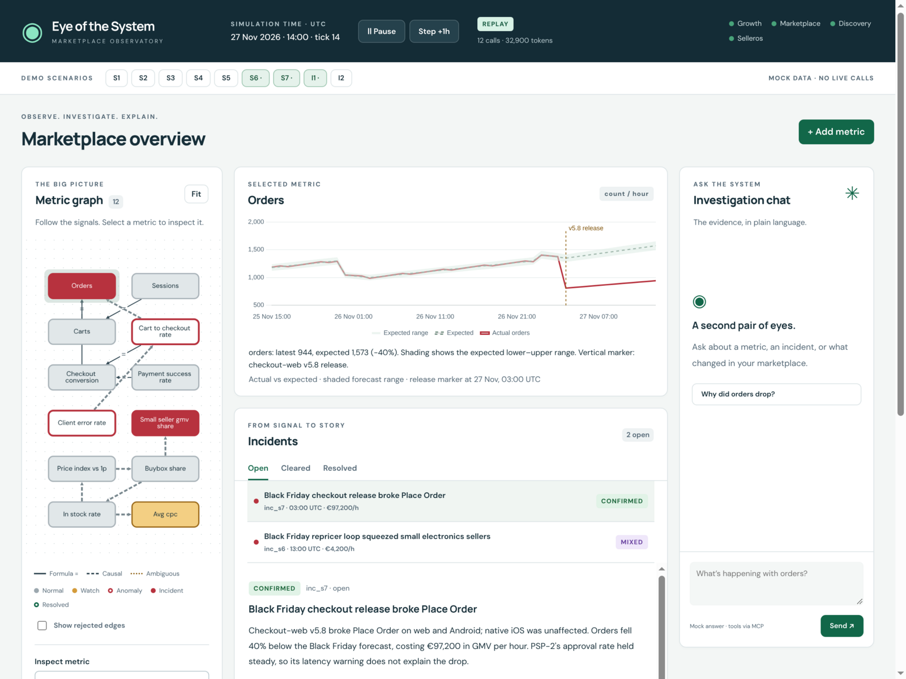
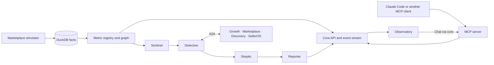

# Eye of the System

Eye of the System watches a simulated marketplace without waiting for a human to ask a question. It ranks unusual changes by business impact, follows a graph of metrics to find causes, and publishes incidents with evidence, affected sellers or platforms, and suggested actions. The Black Friday demo contrasts a planned traffic surge, a checkout outage, and a seller cascade that marketplace totals can hide.

## Observatory



*Browser screenshot of [mock mode](web/README.md), with fixture data rather than live results.*

## Run it

### UI preview (no credentials)

```sh
uv python install 3.13
uv sync
uv run python -m http.server --bind 127.0.0.1 --directory web 5500
```

Open `http://localhost:5500/?mock=1` for the graph, sample incidents, and investigation trail.

### Local stack and rehearsal

For the integrated demo, set `ANTHROPIC_API_KEY` in your environment for live or record mode. Start the services with `./scripts/dev.sh`; core prepares 28 days of history on first startup. Check `http://localhost:8000/api/status`. Once [live UI wiring](docs/tasks/T22-ui-live.md) lands, open the observatory at `http://localhost:8000/`. For a rehearsal from Black Friday 00:00 UTC, start with a fresh simulator world and its clock paused (`sim.autostart: false` in local settings).

```sh
uv run python scripts/demo_run.py --script demo
```

The runner injects I1 at the start, S7 at +3h, S6 at +6h, adds `refund_rate` at +10h, and clears S7 at +12h. It pauses the automatic clock and advances it through the API. `--speed 5` (the default) waits five real seconds before each simulated hour, plus processing time. On success the runner preserves the original pause state; on an API failure it stops without resuming or undoing changes. Advance the clock beyond the scripted window to show S-99 entering the market. Use a fresh world for another run.

Add `--record` to save **core** LLM responses to `data/llm_cache.jsonl`. Keep the cache out of git and use `llm.mode: replay` in your local settings for the next launch. Replay may still call the API on a cache miss. The HTTP mode switch affects only core, not the separately running specialists.

### Docker

Once [the deployment card](docs/tasks/T26-deployment.md) lands, use Docker Compose. Populate `.env` from `.env.example` with the API key and demo credentials, then run `docker compose up --build -d` and open `http://localhost:8080/`. See the [deployment guide](docs/specs/16-deployment.md#5-steps-to-deploy-for-the-team) for the password-protected tunnel and Codespaces backup.

## Architecture



Cartographer dry-runs new metric SQL and proposes where to place the metric in the graph. See the [architecture spec](docs/specs/01-architecture.md) and [public API](docs/specs/13-api-and-ui.md).

## How it investigates

1. **What to watch.** Sentinel ranks changes by surprise × impact × data completeness. It also checks for segments moving in the opposite direction from the total.
2. **Where to look.** Detective follows formula identities, then dimensional breakdowns and causal hypotheses. It asks specialists over A2A when it needs domain evidence.
3. **When to stop.** To confirm a cause, explain at least 70% of the change, use at least two independent evidence groups, and refute material alternatives. Otherwise keep the uncertainty visible. Reporter tracks impact and the incident lifecycle.

Code computes the numbers; agents decide what evidence to collect and how to explain it.

## Scenarios

These are expected outcomes, not measured scores. See the [scenario spec](docs/specs/04-scenarios.md) for the controls and decoys.

| ID | Scenario | Expected outcome |
| --- | --- | --- |
| S1 | ADV-3 exhausts its ad budget by 10:00 | Confirm the pacing regression |
| S2 | Home sales fall despite stable demand | Confirm the purchase-order shortfall |
| S3 | German search traffic holds, but conversion falls | Confirm the search ranker regression |
| S4 | For You clicks rise, but purchases fall | Confirm the feed relevance regression |
| S5 | Orders rise, but contribution falls | Separate planned growth from the margin fault |
| S6 | Black Friday repricing and a hijacker squeeze small sellers | Mixed causes; notify SellerOS |
| S7 | A checkout release breaks web and Android | Confirm the release fault; refute PSP-2 and recommend rollback |
| I1 | Planned Black Friday campaign | Innocent; no business alert |
| I2 | French orders arrive late | Defer or flag a data issue; no business alert |

## A2A and MCP

| Protocol | Local address |
| --- | --- |
| [A2A specialists](docs/specs/10-a2a-and-specialists.md) | `http://localhost:8200/growth`, `/marketplace`, `/discovery` |
| [A2A SellerOS](docs/specs/11-selleros-external.md) | `http://localhost:8300` |
| [MCP, streamable HTTP](docs/specs/12-mcp-server.md) | `http://localhost:8100/mcp` |

Append `/.well-known/agent-card.json` to an A2A base address to inspect its card. For the demo, ask an MCP client: “What is broken right now and who is affected?”

## Eval results

No measured results yet. The [scenario eval card](docs/tasks/T23-oracle-and-eval.md) defines the harness; the [eval spec](docs/specs/14-testing-and-evals.md) defines the pass criteria. Mock incidents are not eval evidence.

| Run | Result | Ticks to detect | LLM calls |
| --- | --- | --- | --- |
| S1–S7, I1–I2, D1–D5 | Not yet measured | — | — |

## Limitations

The marketplace is synthetic. Causal links are hypotheses until corroborated; the system recommends interventions rather than applying production changes. The full rehearsal still requires the scenario, Cartographer, and MCP integrations, plus [live UI wiring](docs/tasks/T22-ui-live.md) for browser verification. See the [documentation index](docs/README.md) for the implementation plan and specs.
