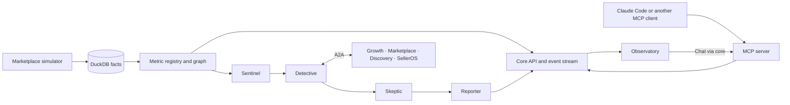

# Eye of the System

Eye of the System monitors a graph of metrics without waiting for someone to ask a question. It ranks unusual changes by business impact, investigates possible causes, and publishes incidents with evidence and suggested actions. The platform is not tied to one use case: in [“The €9 headphones”](docs/specs/15-demo-and-pitch.md#1-demo-script-3-min-the-9-headphones), a simulated marketplace investigates one seller's unplanned price drop during a planned electronics coupon day.

## Observatory

The [live observatory](web/README.md) is served by Core. [Earlier API preview](docs/assets/observatory-live.png): the chart shows simulated orders after injecting I1 and S7, not results from the headphones rehearsal.

## Run it

### Docker Compose (live stack or credential-free wave gate)

```sh
cp .env.example .env
docker compose up -d --build --wait
./scripts/smoke.sh
docker compose ps
# Stop, preserving data (add -v to reset the world):
docker compose down
```

Open http://127.0.0.1:8000 for the UI served by Core. Each Python service has
its own container and HTTP health check; `sim-generate` exits successfully after
initializing the DuckDB snapshot. `eye-data` reads that DuckDB snapshot
from a read-only mount and serves it to Core on a private network; no warehouse
port is published. Alongside it, continuous `sim` backfills/resumes its private
`sim-world` volume and publishes hourly Parquet to the named `sim-lake` volume.
Only continuous `sim` publishes the shared SellerOS export; SellerOS waits for
its `/health`. The simulator uses host port 8100 and MCP starts at 8110.
Host ports can be changed in
`.env`. Compose uses the normal live Anthropic LLM defaults, matching
`config/settings.yaml`. Set `ANTHROPIC_API_KEY` in `.env` to run real agents;
Compose does not override credentials. For OpenRouter, add the same `llm`
provider/model settings shown below to `config/compose.yaml`, set
`OPENROUTER_API_KEY` in `.env`, and add SellerOS's provider/model variables there
too. Never commit keys.

CI copies `.env.example`, whose keys are empty, so the startup/API gate makes no
model requests. Missing credentials produce the existing `refinement_unavailable`
warning without preventing startup; this is not an agent-quality eval.
This Compose setup reads the initial snapshot; the Core clock only advances
when the warehouse has another complete hour. Neither Core nor `eye-data` mounts
`sim-lake` yet; wiring the live lake is a separate data-service follow-up.
The private continuous simulator and one-shot snapshot use separate world volumes
to avoid concurrent DuckDB writers. Do not scale `sim` against the same volumes.
Containers bind
`EYE_BIND_HOST=0.0.0.0`; local commands still default to `127.0.0.1`.
`EYE_CORE_URL`, `EYE_MCP_URL`, and `SELLEROS_URL` configure network addresses;
`EYE_MCP_ALLOWED_HOSTS` adds comma-separated Host headers to MCP's loopback
allowlist (Compose adds `eye-mcp:8100`), retaining DNS-rebinding protection;
the A2A URLs live in settings. SellerOS uses `SELLEROS_DATA_DIR` for its shared
export directory. Compose uses host port ranges and no fixed container names,
so services can be independently replicated (for example,
`docker compose up -d --wait --scale eye-specialists=2`).
Core and SellerOS currently retain process-local state/file-backed storage;
multiple replicas are not a distributed-state or multi-writer deployment.

### Simulator controls

Scenario controls now belong exclusively to the [continuous simulator service](sim/README.md), not Core, MCP, chat or the Observatory. Start `uv run eye-sim serve`; trigger with `curl -fsS -X POST http://127.0.0.1:8100/scenarios/s8`, inspect `/status`, and clear with `DELETE /scenarios/s8`. S8 starts the planned coupon day immediately and the seller typo after `typo_delay_hours` (default 1).

The legacy `scripts/demo_run.py` and rehearsal instructions below predate this boundary and are not compatible with the removed core scenario endpoints. A separate demo CLI follows in Wave 2. Do not run Core and the simulator service as concurrent writers to the same world. Until the data-service migration, use Core's existing DuckDB source for externally ingested data.

### Legacy local stack and rehearsal

From a fresh checkout of `main` with [uv](https://docs.astral.sh/uv/getting-started/installation/) and Bash 4.3 or later (required by the stack launcher):

```sh
uv python install 3.13
uv sync --locked
```

In your local `config/settings.yaml`, set `sim.autostart: false` (nested under `sim`). Use the default simulator data source (`data.source: sim`); a DuckDB warehouse does not expose the demo scenarios. Leave `sim.start_ts` unchanged so recordings still match. Use a fresh checkout or worktree so the clock, incidents, and SellerOS actions are reset.

**Claude (default):** Set `ANTHROPIC_API_KEY` from a funded workspace in the environment that starts the stack. Core, the specialists, and SellerOS use Claude by default.

**OpenRouter (alternative):** Set `OPENROUTER_API_KEY` in the stack's environment. Change these values in your local `llm` section; keep the rest of the file unchanged:

```yaml
llm:
  provider: openai_compatible
  models:
    default: nvidia/nemotron-3.5-lightning:free
```

SellerOS does not read Core's settings. Before starting the stack, set its [provider and model](packages/selleros/README.md) in the same shell:

```sh
export SELLEROS_PROVIDER=openai_compatible
export SELLEROS_MODEL=nvidia/nemotron-3.5-lightning:free
```

Core and SellerOS already default to `https://openrouter.ai/api/v1` and read the key from `OPENROUTER_API_KEY` in this mode. Do not put API keys in settings or commit local overrides. A free-model D6 eval did not pass; see [Eval results](#eval-results).

Start all services in the first terminal:

```sh
./scripts/dev.sh
```

On a fresh world, Core generates 28 days of history and builds the seed graph before serving the API. Model refinement runs in the background; successful results are saved to `data/graph.json` and reused on later starts. If Core logs `refinement_unavailable`, check your provider credentials and model availability before rehearsing. In a second terminal at the checkout root, check for `"tick": 0` and `"paused": true`:

```sh
curl -fsS http://127.0.0.1:8000/api/status
```

Once ready, open [the observatory](http://127.0.0.1:8000/) and run:

```sh
uv run python scripts/demo_run.py --script demo
```

The legacy runner prepared 09:00 with a coupon campaign active since midnight and injected S8 at 10:00, and reports whether the monitor deferred the incomplete hour. Once the S8 incident opens, it adds `fee_per_order` from SQL and waits for the electronics / small third-party seller anomaly to attach. After SellerOS acknowledges the revert, the simulator applies it on the next tick. The runner waits for three normal ticks and resolution of the same incident without clearing S8 manually.

`--speed 5` (the default) waits five real seconds before each simulated hour after setup, plus processing time. The runner prints wall time for each step. On success it preserves the original pause state; on failure it stops without resuming or undoing changes. Use a fresh world for another run.

To reset for another rehearsal, stop `./scripts/dev.sh` with Ctrl+C and wait for all services to exit, then run from the checkout root:

```sh
uv run python scripts/demo_reset.py
./scripts/dev.sh
```

The reset refuses if service processes/ports appear active or either database is locked. It prints each removed file: the simulator world and operations databases (including WALs), graph snapshot, and SellerOS runtime data, including action journals. It keeps the configured Core LLM cache and SellerOS `llm_cache.jsonl`. The graph must be rebuilt because it can contain demo-added metrics, node states and world-derived evidence; keeping it could carry the previous rehearsal into the new one. This also discards saved seed refinement, but recorded model responses remain cached. Unlike the older `scripts/reset.sh` (which deletes all data including caches), this command preserves recordings. After restart, check for tick 0 and a paused clock before running the demo again. `--settings PATH` selects a different settings file; simulator and store paths come from their runtime defaults, not the read-only `data.path` warehouse setting.

To save LLM responses to `data/llm_cache.jsonl`, set `llm.mode: record` in your local settings before launch. Keep the cache out of git and use `llm.mode: replay` for the next launch. Replay may still call the API on a cache miss. The LLM mode is read only at startup; there is no runtime switch.

### Docker

Once [the deployment card](docs/tasks/T26-deployment.md) lands, use Docker Compose. Populate `.env` from `.env.example` with the API key and demo credentials, then run `docker compose up --build -d` and open `http://localhost:8080/`. See the [deployment guide](docs/specs/16-deployment.md#5-steps-to-deploy-for-the-team) for the password-protected tunnel and Codespaces backup.

### Separate read-only data service

With a running Parquet producer, start `uv run eye-data` with the same `SIM_LAKE_DIR`
(default `data/lake`). To use an existing warehouse instead, set `EYE_WAREHOUSE_PATH`
on the data service. Check readiness at `http://127.0.0.1:8150/healthz`; it returns
the completed time range once at least one hour is ready.

Run `EYE_DATA_URL=http://127.0.0.1:8150 uv run eye-core` to read metrics, the causal
graph, and partition status over HTTP. The Core clock consumes completed hours
without advancing the producer. Scenario controls and adding metrics from SQL
remain available only in the legacy local mode.

## Workspace layout

The implicit `eye` namespace is split across `packages/{contracts,data,llm,agents,orchestrator,specialists,mcp}/src/eye` and `sim/src/eye/sim`. SellerOS lives independently in `packages/selleros`. The reusable `agent_runtime` package lives in `packages/agent_runtime/src/agent_runtime` and imports neither Eye nor SellerOS. Eye tests and scripts stay at the root; the LLM member owns shared prompt resources.

`uv sync --locked` installs every member. From the repository root run `uv run eye-core`, `uv run eye-specialists`, `uv run eye-mcp`, or `uv run selleros`; `uv run eye-sim --help` lists simulator commands. `uv run lint-imports` enforces import boundaries; `uv run pytest -m "not live" -q` runs Eye, SellerOS, and agent runtime tests. Runtime tests use scripted models with real model requests disabled.

## Architecture



Cartographer dry-runs new metric SQL and proposes where to place the metric in the graph. See the [architecture spec](docs/specs/01-architecture.md) and [public API](docs/specs/13-api-and-ui.md).

## How it investigates

1. **What to watch.** Sentinel ranks changes by surprise × impact × data completeness. It also checks for segments moving in the opposite direction from the total.
2. **Where to look.** Detective follows formula identities, then dimensional breakdowns and causal hypotheses. It asks specialists over A2A when it needs domain evidence.
3. **When to stop.** To confirm a cause, explain at least 70% of the change, use at least two independent evidence groups, and refute material alternatives. Otherwise keep the uncertainty visible. Reporter tracks impact and the incident lifecycle.

Code computes the numbers; agents decide what evidence to collect and how to explain it.

## Scenarios

Only S8 is enabled by the simulator. It includes the planned electronics coupon day; I3 is no longer a separate trigger. The table below preserves historical oracle expectations, not supported controls or measured scores. See the [scenario spec](docs/specs/04-scenarios.md) for background.

| ID | Scenario | Expected outcome |
| --- | --- | --- |
| S1 | ADV-3 exhausts its ad budget by 10:00 | Confirm the pacing regression |
| S2 | Home sales fall despite stable demand | Confirm the purchase-order shortfall |
| S3 | German search traffic holds, but conversion falls | Confirm the search ranker regression |
| S4 | For You clicks rise, but purchases fall | Confirm the feed relevance regression |
| S5 | Orders rise, but contribution falls | Separate planned growth from the margin fault |
| S6 | Black Friday repricing and a hijacker squeeze small sellers | Mixed causes; notify SellerOS |
| S7 | A checkout release breaks web and Android | Confirm the release fault; refute PSP-2 and recommend rollback |
| S8 | One seller enters the wrong electronics price | Confirm the price error with SellerOS; track recovery |
| I1 | Planned Black Friday campaign | Innocent; no business alert |
| I2 | French orders arrive late | Defer or flag a data issue; no business alert |
| coupon_day (S8 confounder) | Planned 10% electronics coupon day | Recognize the expected change; no business alert |

## A2A and MCP

| Protocol | Local address |
| --- | --- |
| [A2A specialists](docs/specs/10-a2a-and-specialists.md) | `http://localhost:8200/growth`, `/marketplace`, `/discovery` |
| [A2A SellerOS](docs/specs/11-selleros-external.md) | `http://localhost:8300` |
| [MCP, streamable HTTP](docs/specs/12-mcp-server.md) | `http://localhost:8100/mcp` locally; `http://localhost:8110/mcp` in Compose |

Append `/.well-known/agent-card.json` to an A2A base address to inspect its card. In Q&A, try asking an MCP client: “What is broken right now and who is affected?”

## Eval results

The [scenario eval card](docs/tasks/T23-oracle-and-eval.md) defines the harness; the [eval spec](docs/specs/14-testing-and-evals.md) defines the pass criteria. Mock incidents are not eval evidence.

| Run | Result | Ticks to detect | LLM calls |
| --- | --- | --- | --- |
| S3 (offline replay) | Failed: 4 cache misses; no incident to score | — | 0 |
| S8 (OpenRouter free) | Failed: no matching incident | — | 180 |
| D6 (OpenRouter free) | Failed: no matching incident | — | 118 |
| Other scenarios and combined runs | Not yet measured | — | — |

The [S8 and D6 evals](https://github.com/hacklab11/apollo-11/pull/46) used `nvidia/nemotron-3-ultra-550b-a55b:free`. Sentinel logged `LLMUnavailable` after S8 was injected. These are eval harness results, not a passing local stack rehearsal.

## Limitations

The marketplace is synthetic: the five headphones and the €99 → €9 prices are narrative examples. The live run uses the affected electronics SKUs and their observed prices. Causal links are hypotheses until corroborated; the demo's SellerOS intervention changes only the simulated world. See the [documentation index](docs/README.md) for the implementation plan and specs.
