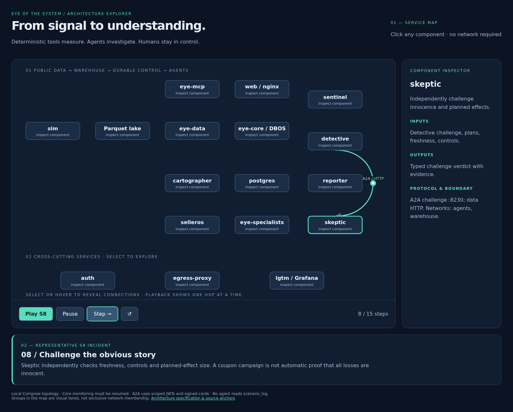
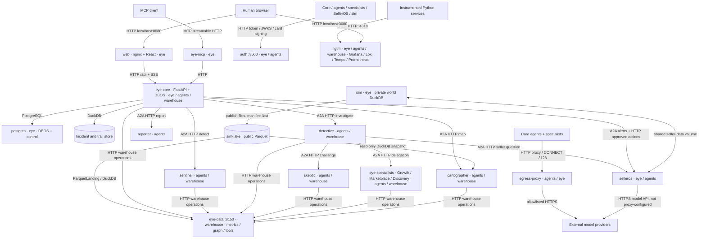
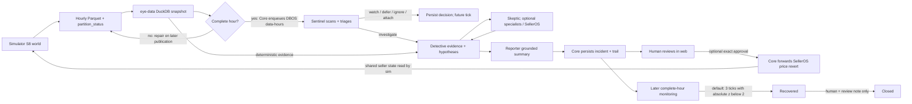
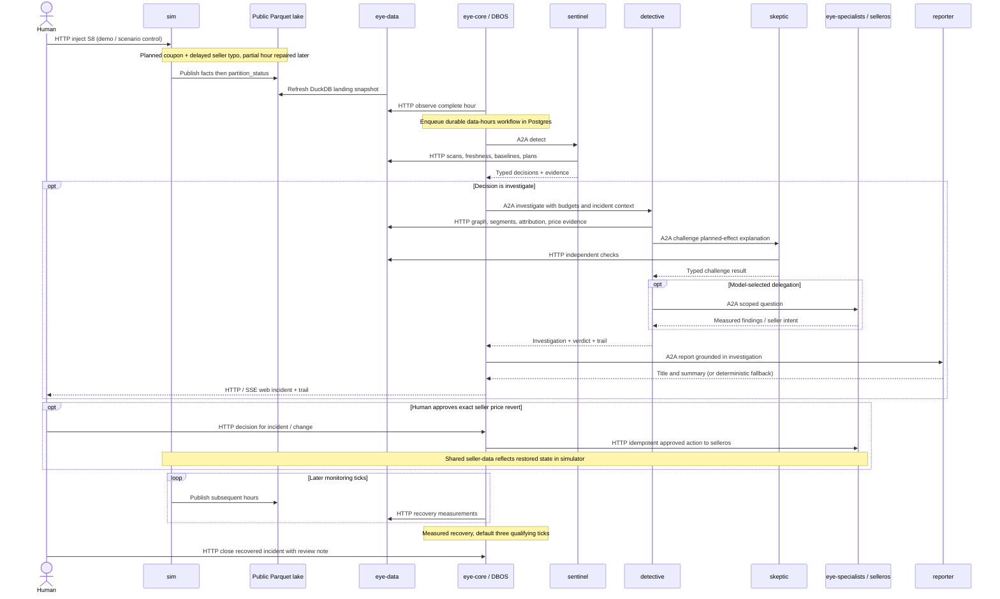

# Architecture

Eye is a monitoring and incident workspace: deterministic tools measure, agents interpret,
and humans approve seller actions and close recovered incidents.

## Explore the system

[Interactive service map and animated S8 walkthrough](../architecture/walkthrough.html)
is a single offline HTML file. GitHub shows its source: clone the repo and run
`open docs/architecture/walkthrough.html` (macOS), or open the file in your browser.
Click services for their contracts; play, pause or step through an illustrative S8 run.
Delegation is model-selected, not a guaranteed fixed itinerary.

Explore the service map and follow an illustrative S8 incident offline.

## Compose deployment and protocols

Network membership is shown in labels because services bridge networks. `agents` and
`warehouse` are internal networks; `eye` is not. Arrows show logical communication,
not firewall rules. HTTP is internal plaintext in local Compose. A2A calls use scoped
OAuth JWTs and verified signed cards; the local nginx operator identity is separate.

All Compose services are included above. `sim-lake`, incident storage, caller and telemetry
groups are explanatory nodes, not extra services. Host loopback also exposes sim (8100),
SellerOS (8300–8309) and MCP (8110–8119); agents and warehouse have no host ports.
Reporter has no warehouse network or data tools. Cartographer's lake snapshot is the explicit
exception to HTTP-only agent data access. SellerOS has no proxy environment in Compose.

## End-to-end data flow

The campaign is a planned effect, not proof of innocence. S8's partial first hour is
repaired by republishing; no agent reads private `scenario_log`. A revert is optional
and cannot itself prove recovery. Core monitoring starts paused in default Compose;
resume it with a configured model, or use the scripted offline Compose override.

## S8 incident sequence

This is a representative successful investigation, not a promise that every model run
delegates identically or confirms a root cause. Auth/card discovery and repeated tool
calls are abbreviated; DBOS persists remote call checkpoints, not private model histories.

Source anchors: [Compose](../../compose.yaml),
[workflow](../../packages/orchestrator/src/eye/orchestrator.py),
[warehouse landing](../../packages/data/src/eye/warehouse/landing.py),
[Detective](../../packages/agents/src/eye/agents/detective.py),
[nginx](../../packages/web/nginx.conf), and the service specs below.

## Runtime boundaries

1. `sim` owns private world state and continuously publishes hourly Parquet partitions.
2. `eye-data` reads the lake, computes metrics/baselines/attribution, and stores the metric graph.
3. `eye-core` observes completed hours and enqueues DBOS work. Sentinel selects signals,
   Detective investigates (delegating to Skeptic and specialists), Reporter writes the result.
4. Core owns incidents, approval records, kill switches and audit history. Only measured recovery
   can lead to human closure.
5. `web` serves React and proxies `/api/`; MCP and the demo CLI use Core over HTTP.
6. Postgres holds workflow/control state; Grafana LGTM receives telemetry. Agents use the egress proxy.

Five core A2A services expose `detect`, `investigate`, `challenge`, `report`, `map`.
The specialists service exposes Growth, Marketplace and Discovery; SellerOS is a separate application.
See [Compose](../../compose.yaml) for networks, mounts and entrypoints.

Core does not import agent implementations. Contract validation, remaining budgets, incident context
and trace context cross service boundaries; private model message histories do not.
Core agents and specialists execute PydanticAI agents through the shared `agent_runtime` harness.
Core and specialist prompts ship as package resources next to their implementations.

See [deployment](deployment.md), [orchestrator](orchestrator.md) and [production criteria](agent-criteria.md).
